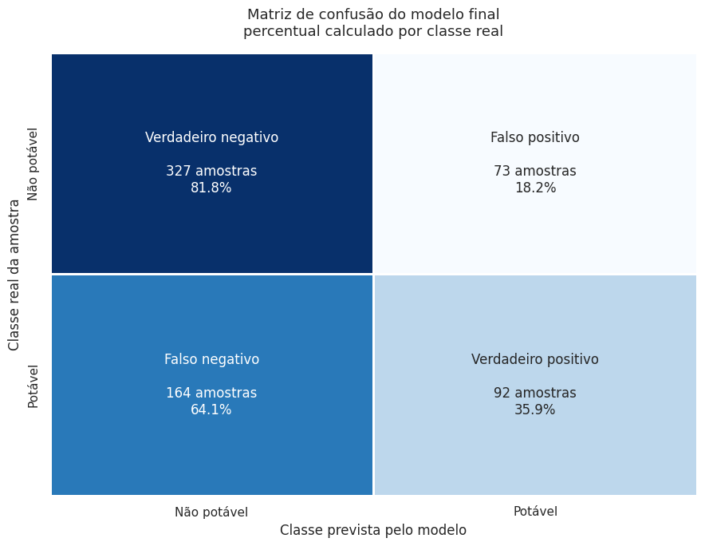
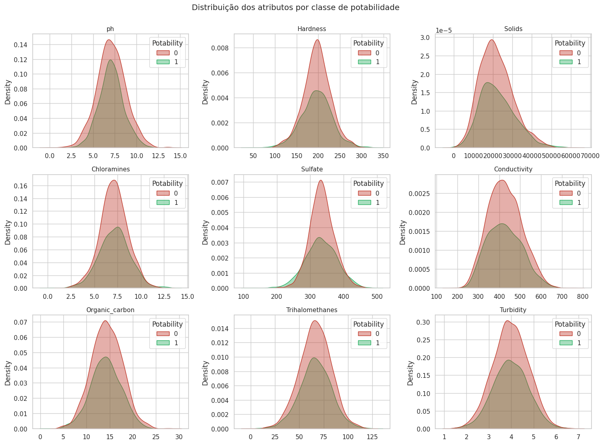
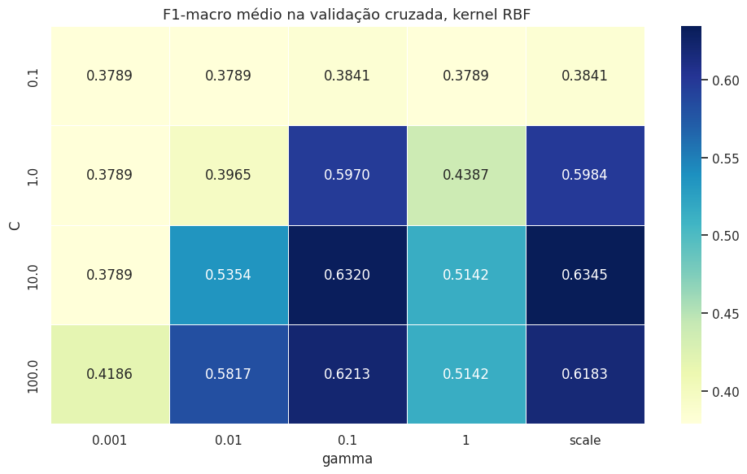

# Classificação de Potabilidade da Água com SVM

Projeto de machine learning que classifica amostras de água como **potáveis** ou **impróprias para consumo** a partir de nove parâmetros físico-químicos, usando **Support Vector Machine (SVM)** com ajuste de hiperparâmetros por **GridSearchCV**.

Projeto acadêmico desenvolvido na disciplina de Inteligência Artificial do curso de Engenharia de Software da Universidade de Mogi das Cruzes (UMC).



## Resultado em resumo

| Modelo | Acurácia | Balanced Accuracy | F1-macro |
|---|---|---|---|
| Linha de base (sempre "não potável") | 60,98% | 50,00% | |
| SVM linear (LinearSVC) | 60,98% | 50,00% | |
| SVM RBF, parâmetros padrão | 67,07% | | |
| **SVM RBF ajustado (C=10, gamma=scale)** | **63,87%** | **58,84%** | **0,5855** |

O ponto central do projeto não é só a acurácia, e sim **entender por que o problema é difícil** e escolher as métricas certas para uma base desbalanceada.

## Dataset

[Water Potability](https://www.kaggle.com/datasets/adityakadiwal/water-potability), disponível no Kaggle.

* 3.276 amostras e 9 atributos numéricos: pH, dureza, sólidos dissolvidos, cloraminas, sulfato, condutividade, carbono orgânico, trialometanos e turbidez
* Variável alvo `Potability`: 1 para potável e 0 para imprópria
* Classes desbalanceadas: 61% impróprias e 39% potáveis

## Etapas do projeto

**1. Análise exploratória.** Distribuição dos atributos, valores atípicos, distribuição por classe e matriz de correlação. A principal descoberta é que **as duas classes ocupam praticamente as mesmas faixas de valores em todos os atributos**, e nenhuma variável tem correlação relevante com o alvo (máximo de 0,03). Isso indica que não existe fronteira linear entre as classes.



**2. Tratamento de dados ausentes.** Três atributos têm valores faltantes: sulfato (23,8%), pH (15,0%) e trialometanos (4,9%). Três estratégias foram construídas e comparadas:

* A. Remover as linhas incompletas, o que custa 38,6% da base
* B. Preencher com a mediana global
* C. Preencher com a mediana de cada classe

A mediana foi escolhida no lugar da média por ser menos sensível aos valores atípicos vistos nos boxplots.

**3. Preparação.** Divisão estratificada de 80% para treino e 20% para teste, e padronização com `StandardScaler` ajustado **somente no treino**, para que o conjunto de teste continue inédito.

**4. Modelagem.** Linha de base trivial, SVM com parâmetros padrão como referência e `GridSearchCV` com validação cruzada estratificada de 5 partes, testando 40 combinações de C, gamma e kernel (RBF e polinomial), otimizando o **F1-macro**. O kernel linear foi avaliado separadamente com `LinearSVC`.



**5. Avaliação.** Acurácia, Balanced Accuracy, precisão, revocação, F1 e matriz de confusão no conjunto de teste.

## Por que acurácia não basta

Um modelo que respondesse "não potável" para tudo já acertaria 61%. Por isso o projeto acompanha a **Balanced Accuracy** e o **F1-macro**, que dão o mesmo peso às duas classes. O kernel linear mostra bem esse problema: ele atinge 60,98% de acurácia, mas nunca prevê a classe potável (revocação 0).

Na matriz de confusão, o erro mais grave do ponto de vista sanitário é o **falso positivo**, ou seja, água imprópria classificada como potável. O modelo final comete esse erro em 18,2% das amostras impróprias.

## Limitações e próximos passos

* O modelo ajustado otimiza o F1-macro e por isso tem acurácia menor que o SVM padrão, mas equilibra melhor as duas classes.
* O ganho sobre a linha de base é modesto, o que é coerente com a análise exploratória: os atributos, isoladamente, quase não separam as classes.
* A imputação pela mediana de cada classe usa o rótulo antes da divisão entre treino e teste, o que pode vazar informação. Uma versão mais correta faria a imputação dentro de um `Pipeline`, só com dados de treino.
* Próximos passos: testar `class_weight="balanced"`, ajustar o limiar de decisão para reduzir falsos positivos e comparar com modelos baseados em árvores, como Random Forest e XGBoost.

## Tecnologias

Python, pandas, NumPy, scikit-learn, Matplotlib, Seaborn, Jupyter Notebook e Kaggle.

## Como executar

```bash
git clone https://github.com/JvF777/water-potability-svm.git
cd water-potability-svm
pip install -r requirements.txt
jupyter notebook water_potability_svm.ipynb
```

Baixe o arquivo `water_potability.csv` no [Kaggle](https://www.kaggle.com/datasets/adityakadiwal/water-potability) e ajuste o caminho na célula de leitura do dataset. O notebook também roda direto no Kaggle, sem alterações.

## Autor

**João Vitor Ferreira Pedroso**
Estudante de Engenharia de Software, UMC
[LinkedIn](https://www.linkedin.com/in/joaovitorferreirapedroso) · [GitHub](https://github.com/JvF777)
